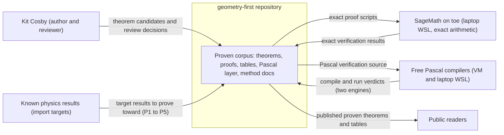
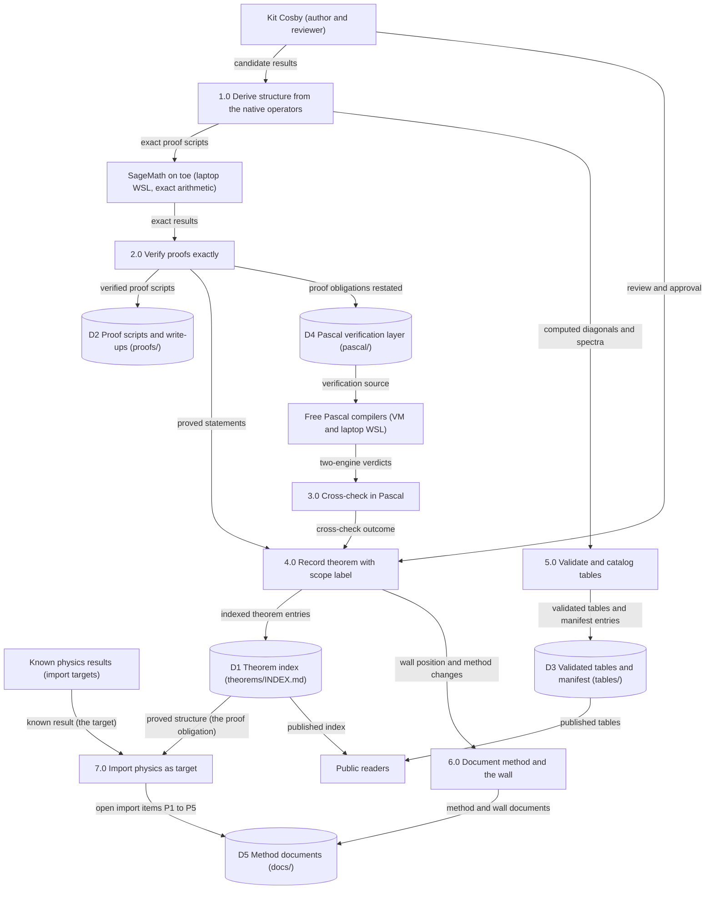
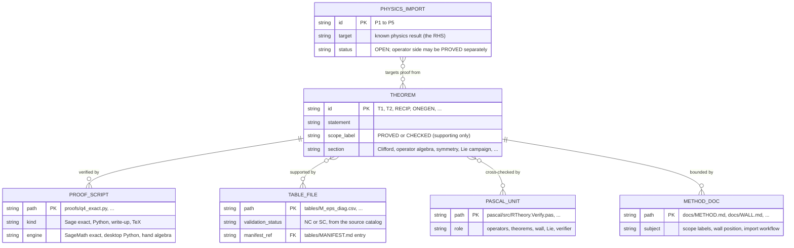

Living document — update these diagrams when adding features.

# geometry-first — Architecture

The clean-break proven core of the R Theory program: **only** theorems with complete proofs, validated tables, and the documents that describe the derived structure. No E8, no Axiom Zero, no SU(8), no Standard Model content — everything on the far side of the wall (see `docs/WALL.md`) is excluded until it is proven. Every claim carries exactly one scope label: **PROVED** (exact SageMath over ℚ/ℚ̄, Gröbner bases, exact nullspaces, or hand-verifiable symbolic algebra) or **CHECKED** (numerical only, included solely when supporting a PROVED theorem). Labels ASSERTED / OPEN / INCOMPLETE / HYPOTHESIS never appear as content here.

The corpus: `theorems/INDEX.md` (27 PROVED pre-Lie theorems, plus a separately counted Lie campaign section), `proofs/` (243 files at HEAD `83c10989` — exact Sage/Python proof scripts and theorem write-ups, including the 2026-11 sync areas below), `tables/` (29 validated CSVs + `MANIFEST.md`), `pascal/` (a Free Pascal re-verification layer: 7 source units + the `VerifyProofs` program), and `docs/` (`METHOD.md`, `WALL.md`, `PHYSICS_IMPORT_WORKFLOW.md`).

**2026-11-07 revision:** two staged syncs (Kit's go-aheads, 2026-11-02 and 2026-11-04/05) landed the local proof pile on `main`: the 2026-11-02 sync brought INDEX status fixes, the Lie campaign section, the Q7/run150b scripts, and the current Pascal layer sources; the 2026-11-05 sync added 96 proof scripts/notes (E6 campaign, so(11)/so(16) ladder, blending, Clifford gluing, Kostant-Dirac, pure spinor, fermion miniature) plus 3 corrections, including narrowing E104's scope to the five tested diagonal patterns (its universal form was falsified 2026-10-26; the falsification is recorded in the index itself). The component architecture — index, proof scripts, tables, Pascal layer, method docs — is unchanged; what changed is corpus size and the presence of new campaign working areas in `proofs/` that are not yet indexed theorems. Counts and grounding below are updated to HEAD `83c10989`.

## Context diagram

## Level-1 DFD

## ER diagram

## Grounding notes

- OBSERVED (README.md): the repo holds only PROVED results plus CHECKED items supporting a PROVED theorem; E8, Axiom Zero, SU(8), the Standard Model, dynamic coupling, and theological interpretations are explicitly excluded as not proven.
- OBSERVED (theorems/INDEX.md): 27 PROVED pre-Lie theorems, each with statement, status, and proof script; T4* is carried as strong evidence (2 solutions over ℚ̄, both non-real; 0 real) with the real-algebraic emptiness proof explicitly pending — the gap is stated, not hidden.
- OBSERVED (docs/METHOD.md): scope labels are PROVED and CHECKED only; proof standards are exact-over-numeric, no hidden axioms, failures disclosed, every PROVED theorem reproducible from a script in `proofs/`.
- OBSERVED (docs/WALL.md): the wall is located at the complex-structure gap on ℝ¹⁶ (no real J²=−I in the intertwiner space); SU(8), fermion quantum numbers, a physical projection (Γ), and coupling dynamics are all on the far side.
- OBSERVED (proofs/WORKFLOW.md): the CHECKED→PROVED conversion runs exact SageMath 9.5 on the laptop (WSL `lampy` distro, user root); the execution log records Q4/Q5/Q6a as PROVED 2026-10-07/08 and D2/D3 structure results.
- OBSERVED (git tree, HEAD `7f6eace2`): 191 files — proofs/ 145, tables/ 30 (29 CSV + MANIFEST.md), pascal/ 9, docs/ 3, theorems/ 1 (INDEX.md), plus README.md and LICENSE. **Superseded in part by the 2026-11-07 bullet below (proofs/ count and HEAD).**
- OBSERVED (pascal/README.md, pascal/src/): the Pascal layer re-verifies the corpus in Free Pascal (units for types, operators, theorems, wall, and Lie structure, plus the VerifyProofs program) as an independent second engine.
- OBSERVED (docs/PHYSICS_IMPORT_WORKFLOW.md): physics enters as the known result (the target); the repo's job is the proof. Import items P1–P5 are OPEN; where an operator side is PROVED, the physical identification remains OPEN.
- INFERRED: the Pascal layer is compiled and run on both FPC installs (this VM and laptop WSL) before a result is called verified — the two-engine cross-check pattern; the repo itself states the layer's role but not the dual-run procedure.
- OBSERVED (commits 93c0e26d…83c10989, 2026-11-02 and 2026-11-05; directory listings at HEAD `83c10989`, 2026-11-07): the 2026-11-02 staged sync (13 commits, Kit go-ahead) brought INDEX status fixes, the Lie campaign section, Q7/run150b scripts, and the current Pascal layer sources; the 2026-11-05 sync (83c10989) added 96 new proof scripts/notes — E6 campaign, so(11)/so(16) ladder, blending, Clifford gluing, Kostant-Dirac, pure spinor, fermion miniature — plus 3 corrections. `proofs/` now lists 243 entries (e.g. `blending_odd_solve.py`, `clifford_gluing_toy_check_sage.py` are present at HEAD); `tables/` still lists 30 entries (29 CSV + MANIFEST.md).
- OBSERVED (theorems/INDEX.md at HEAD `83c10989`): the index structure is unchanged — 27 PROVED pre-Lie theorems plus the separately counted Lie campaign (2026-10-12) with per-entry scope labels including CHECKED parts and OPEN items; E104 is carried at its narrowed scope ("PROVED for the five tested patterns only; the universal claim is FALSE — falsified 2026-10-26 by verified counterexample"). The 2026-11 campaign files in `proofs/` are working areas; they do not yet appear as indexed theorems, so no new THEOREM rows are drawn for them.
